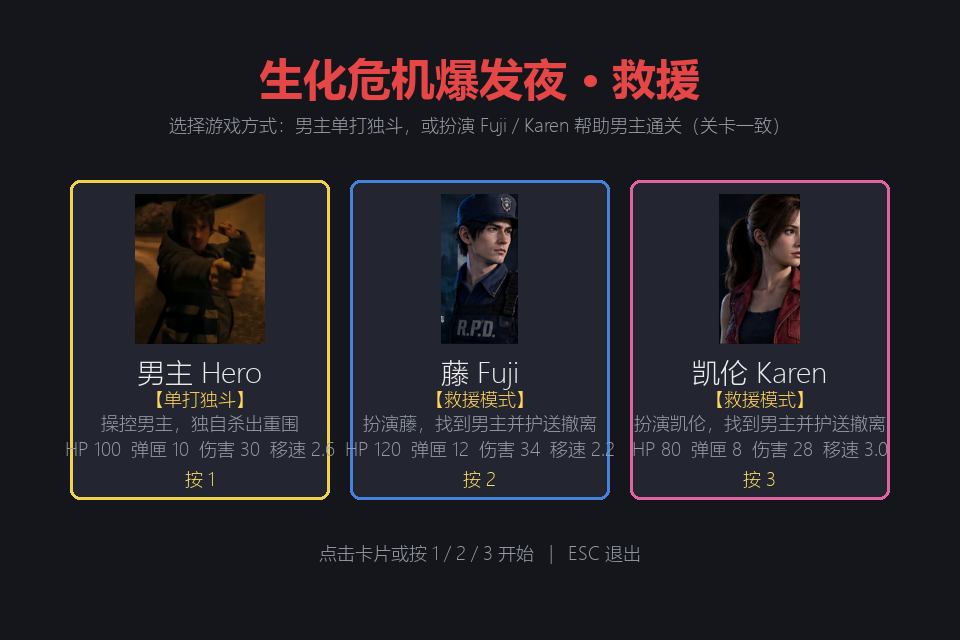
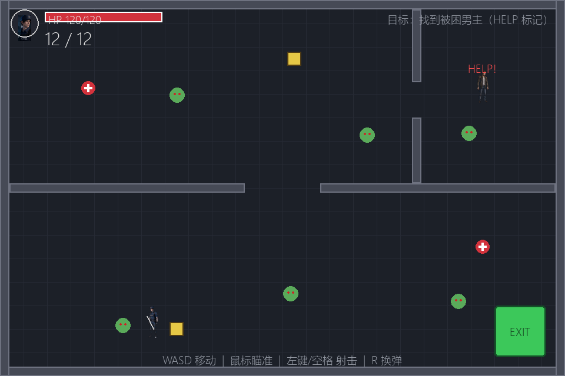
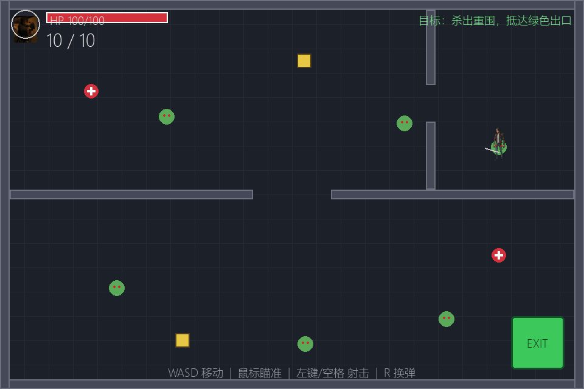

# 生化危机爆发夜 · 救援（Resident Evil: Outbreak Night Rescue）

一款用 **Python + pygame** 实现的俯视角 2D 生存射击小游戏 Demo。

T 病毒在浣熊市爆发，男主被困在建筑物深处。你可以选择：

- **男主·单打独斗** —— 操控男主从关押点独自杀出重围，抵达出口；
- **救援模式** —— 扮演 **藤 Fuji** 或 **凯伦 Karen** 突入丧尸群，找到男主并护送他安全撤离。

两种模式共用同一关卡（墙体布局、丧尸、道具完全一致），方便对比体验。



## 游戏截图

| 救援模式（Fuji 视角） | 单打独斗（男主视角） |
| --- | --- |
|  |  |

## 运行方式

```bash
pip install pygame
python main.py
```

- 依赖：Python 3.10+，pygame 2.x（开发环境为 Python 3.12.4 + pygame 2.6.1）
- 全部素材已随仓库提供（`assets/`），无需额外下载
- 若缺少中文字体，界面文字可能回退为默认字体（Windows 自带微软雅黑/黑体）

## 操作说明

| 按键 | 功能 |
| --- | --- |
| `1` / `2` / `3`（菜单） | 选择：男主单打独斗 / Fuji 救援 / Karen 救援 |
| `W A S D` 或方向键 | 移动 |
| 鼠标 | 瞄准 |
| 鼠标左键 / 空格 | 射击（可按住连发，受射速限制） |
| `R` | 换弹 |
| `ESC` | 退出 |
| 结算后 `R` | 返回菜单 |

## 角色设定

| 角色 | HP | 弹匣 | 单发伤害 | 移速 | 定位 |
| --- | --- | --- | --- | --- | --- |
| 男主 Hero | 100 | 10 | 30 | 2.6 | 均衡型，被困于建筑深处 |
| 藤 Fuji | 120 | 12 | 34 | 2.2 | 重装稳扎型：R.P.D. 警员，血厚伤害高 |
| 凯伦 Karen | 80 | 8 | 28 | 3.0 | 敏捷游击型：记者，射速与移速快 |

## 玩法规则

- **丧尸 AI**：玩家进入仇恨范围（230px）后追击，范围外随机游走；近身接触造成周期性伤害。
- **道具**：医疗包（+40 HP）、弹药包（补满弹匣），碰到即拾取。
- **救援模式**：靠近男主（HELP 标记）后他开始跟随；丧尸也会攻击男主，**男主阵亡即失败**；两人同时进入绿色 EXIT 区域获胜。
- **单打独斗**：没有 NPC，男主抵达 EXIT 即获胜；HP 归零失败。
- 子弹撞墙消失；丧尸带血条，击毙后消失。

## 项目结构

```
├── main.py            # 入口：python main.py
├── constants.py       # 全部可调参数（角色数值/丧尸数值/颜色/动画）
├── game.py            # 主循环 + 状态机（MENU → PLAYING → WIN/LOSE），双模式逻辑
├── player.py          # 玩家：移动/瞄准/射击/换弹/碰撞 + 精灵动画状态
├── zombie.py          # 丧尸：巡逻/追击 AI、接触伤害、血条
├── hostage.py         # 男主 NPC：呼救、跟随、可被丧尸攻击
├── items.py           # 道具：医疗包 / 弹药包
├── level.py           # 关卡：墙体矩形、出生点、出口、丧尸/道具点位
├── hud.py             # HUD：立绘头像、血条、弹药、任务目标
├── sprites.py         # 精灵帧加载、缩放、翻转、逐帧动画（缺失时矢量回退）
├── assets/
│   ├── source/        # 原始素材（P1 男主立绘、P2 动作素材总表）
│   ├── sprites/       # 切分好的透明动作帧（3 角色 × 4 动作 × 3 帧，共 36 张）
│   └── portraits/     # 菜单/HUD 立绘（3 张）
├── docs/              # README 截图
└── tools/             # 素材与测试工具（见下）
```

## 素材方案

原始素材（`assets/source/`）由两张设定图构成：

- **P1**：男主立绘（整幅带背景的全身像），用于菜单卡片与 HUD 头像；
- **P2**：动作素材总表，深蓝背景网格排布 ——
  男主（行走/跑步/射击）、Fuji（待机/行走/跑步/射击）、Karen（待机/行走/跑步/射击），每个动作 3 帧；顶部含 Fuji / Karen 头像。

切分管线 `tools/build_assets.py`：

1. 按像素网格坐标裁剪每个动作帧；
2. 用**边缘洪水填充**把深蓝背景抠成透明（只移除与边缘相连的背景色，不会误伤深色衣物/头发）；
3. 裁剪透明边距，输出 36 张透明 PNG 与 3 张立绘。

如需重新生成素材（例如调整了网格坐标）：

```bash
python tools/build_assets.py
```

游戏内渲染：所有帧统一缩放到 56px 高、脚底对齐；瞄向左侧时水平翻转；移动时循环播放行走帧，开枪后短暂显示射击帧，静止时播放待机呼吸帧。素材缺失时自动回退为矢量圆形绘制，游戏始终可运行。

## 工具脚本（tools/）

| 脚本 | 用途 |
| --- | --- |
| `build_assets.py` | 素材切分管线（裁剪 → 抠背景 → 输出 PNG） |
| `analyze_assets.py` | 像素投影分析素材布局（行带/列带检测） |
| `cluster_preview.py` | 颜色聚类 ASCII 图，无头环境推断图片结构 |
| `ascii_preview.py` | 图片转 ASCII 亮度图 |
| `contact_sheet.py` | 切分结果拼洋红底校验图 |
| `smoke_test.py` | 无头冒烟测试：素材加载、双模式初始化、胜负路径共 20 项断言 |
| `make_screenshots.py` | 无头渲染 README 截图 |

运行测试：

```bash
python tools/smoke_test.py     # 无需弹窗，CI 友好
```

## 调参指南

所有平衡性数值集中在 [constants.py](constants.py) 顶部注释分区中：

- 角色属性（HP/弹匣/伤害/射速/移速）→ `CHARACTERS`
- 丧尸数值（移速/仇恨范围/攻击力）→ `ZOMBIE_*`
- 动画节奏 → `ANIM_INTERVAL_MS` / `IDLE_INTERVAL_MS` / `SHOOT_ANIM_MS`
- 关卡点位（丧尸/道具/出口）→ [level.py](level.py) `build_level()`

## 已知限制与后续计划

- 丧尸暂为矢量绘制（绿色圆 + 红眼），素材中未提供丧尸帧，后续可接入同风格丧尸精灵；
- 暂无音效（可用 `pygame.mixer` 接入枪声/受伤/拾取音效）；
- 单关卡，可扩展多关卡与丧尸波次；
- 可用 PyInstaller 打包为独立 exe。

## 许可

仅供学习交流使用。角色设定图为用户提供素材，请勿用于商业用途。
